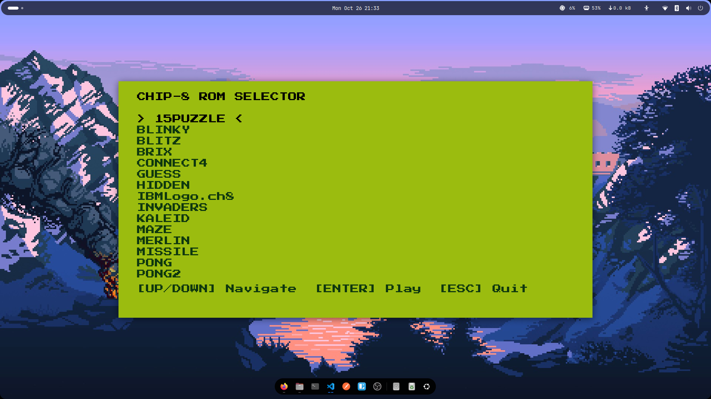
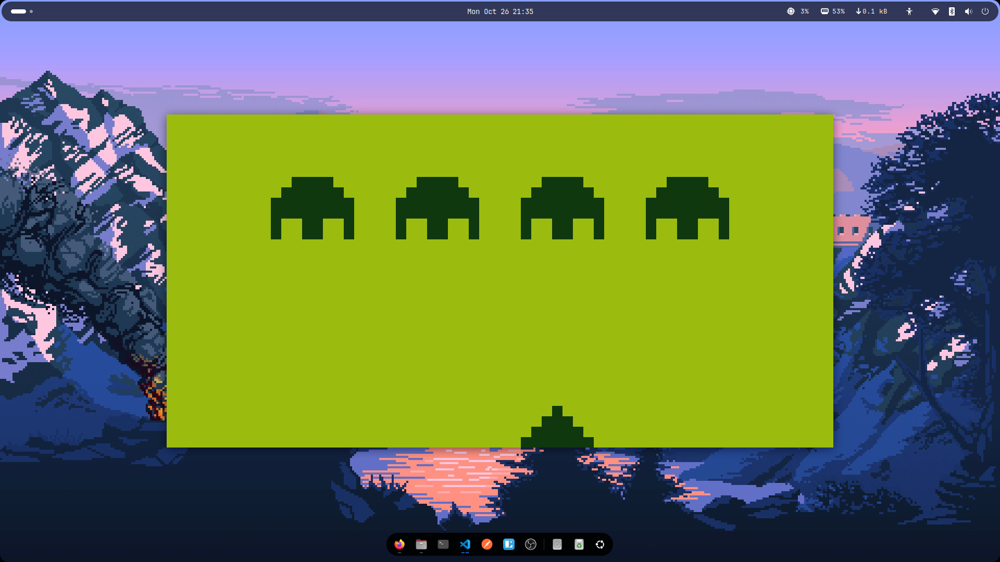

<div align="center">

# 🕹️ CHIP-8 Emulator
### A Modern C++17 Emulator with Retro Vibes & Interactive UI

[](https://isocpp.org/)
[](https://www.libsdl.org/)
[](https://cmake.org/)
[](https://opensource.org/licenses/MIT)

*A fully functional CHIP-8 emulator built from scratch to understand the internals of emulation, from CPU instruction decoding to memory management, hardware timers, and audio synthesis. Featuring a built-in ROM selector menu and a classic Gameboy color palette.*

</div>

---

## 📸 Preview
<p align="center">
  
  
</p>

---

## ✨ Features

- 🧠 **Complete CPU**: Full implementation of the CHIP-8 instruction set.
- 💾 **4KB Memory**: Accurate RAM allocation with a built-in hexadecimal fontset.
- 🖥️ **Interactive UI Menu**: Built-in ROM selector to browse and play games without typing terminal commands.
- 🎨 **Retro Aesthetics**: Customizable Gameboy-style color palettes (Light green background, dark green pixels).
- 📺 **Retro Display**: 64x32 monochrome framebuffer with XOR sprite drawing and collision detection (VF flag).
- ⌨️ **Customizable Controls**: 16-key hex keypad mapped to a standard QWERTY layout.
- ⏱️ **Accurate Timers**: 60Hz Delay and Sound timers driven by a fixed-step accumulator.
- 🔊 **Synthesized Audio**: Square-wave buzzer generated via SDL2 Audio callbacks.
- 🖥️ **Cross-Platform**: Tested on Linux, compatible with macOS and Windows.

---

## 🛠️ Prerequisites & Build

### Dependencies
You will need a C++17 compiler, CMake, SDL2, and SDL2_ttf development libraries.

**Linux (Ubuntu/Debian):**
```bash
sudo apt update
sudo apt install build-essential cmake libsdl2-dev libsdl2-ttf-dev
```

**macOS:**
```bash
brew install cmake sdl2 sdl2_ttf
```

### Font Requirement
The ROM selector menu uses TrueType fonts. You must download a font and place it in the root project folder.
1. Download a retro font (e.g., [Press Start 2P](https://fonts.google.com/specimen/Press+Start+2P) from Google Fonts).
2. Rename the file to **`font.ttf`**.
3. Place `font.ttf` in the root folder (next to `CMakeLists.txt`).

### Compilation
1. Clone the repository:
   ```bash
   git clone https://github.com/Deheryanto/chip.git
   cd chip
   ```

2. Configure and build using CMake:
   ```bash
   cmake -S . -B build
   cmake --build build
   ```

---

## 🚀 Usage

### 1. Interactive Menu (Recommended)
Make sure you have some ROMs (`.ch8`) inside the `roms/` folder. Then run:
```bash
./build/chip8
```
Use the **Up/Down Arrow** keys to navigate and **Enter** to play. Press **ESC** to quit.

### 2. Command Line (Direct Load)
If you want to bypass the menu and load a specific game directly:
```bash
./build/chip8 roms/pong.ch8
```

### 🎮 Default Keypad Mapping

The emulator maps the original 16-key hex keypad to a standard QWERTY layout for maximum comfort:

| CHIP-8 Hex | Keyboard Key | | CHIP-8 Hex | Keyboard Key |
| :---: | :---: | :---: | :---: | :---: |
| **1** | `1` | | **C** | `4` |
| **2** | `2` | | **D** | `R` |
| **3** | `3` | | **E** | `F` |
| **4** | `Q` | | **F** | `V` |
| **5** | `W` | | **7** | `A` |
| **6** | `E` | | **8** | `S` |
| **9** | `D` | | **A** | `Z` |
| **0** | `X` | | **B** | `C` |

*💡 **Tip:** You can easily change these mappings by editing the `keymap` array in `src/main.cpp`.*

- **`ESC`**: Quit the emulator or return to the menu.

---

## 📂 Project Structure

```text
chip-eight/
├── CMakeLists.txt          # Build configuration
├── README.md               # This file
├── font.ttf                # Font required for the ROM Selector Menu
├── include/                # Header files (.h)
│   ├── chip8.h             # Main facade class
│   ├── cpu.h               # CPU and opcode definitions
│   ├── display.h           # 64x32 framebuffer
│   ├── keyboard.h          # 16-key hex keypad
│   ├── memory.h            # 4KB RAM and fontset
│   └── timer.h             # Delay and sound timers
├── roms/                   # Directory for .ch8 games (used by the UI)
└── src/                    # Implementation files (.cpp)
    ├── main.cpp            # SDL2 setup, UI menu, main loop, rendering & audio
    ├── chip8.cpp
    ├── cpu.cpp
    ├── display.cpp
    ├── keyboard.cpp
    ├── memory.cpp
    └── timer.cpp
```

---

## 🧠 Technical Details

- **Architecture**: Utilizes a clean object-oriented approach. The `Chip8` class acts as a facade, orchestrating the independent subsystems (CPU, Memory, Display, Keyboard, Timer).
- **Interactive UI**: Uses `std::filesystem` (C++17) to dynamically read the `roms/` directory and `SDL_ttf` to render the text menu.
- **Timing (Fixed-Step Accumulator)**: The CPU executes at ~700Hz, while the timers and display refresh at exactly 60Hz, ensuring smooth gameplay and accurate emulation regardless of the host machine's framerate.
- **Audio Synthesis**: CHIP-8 only supports a single monophonic square wave. The emulator uses an SDL2 audio callback to generate a 440Hz square wave on the fly whenever the sound timer is greater than zero.
- **Display Logic**: Sprites are drawn using bitwise XOR. The CPU accurately detects sprite collisions (setting the `VF` register) when a drawn sprite overlaps with an existing pixel.

---

## 🎮 Recommended ROMs

To test the emulator and its quirks, you can download CHIP-8 ROMs from these excellent public repositories:
- 🧪 **[Timendus/chip8-test-suite](https://github.com/Timendus/chip8-test-suite)** – The ultimate test suite for opcode accuracy and quirks.
- 🕹️ **[kripod/chip8-roms](https://github.com/kripod/chip8-roms)** – Classic games like Pong, Tetris, Space Invaders, and more.

---

## 📜 License

Distributed under the **MIT License**. See `LICENSE` for more information.

<div align="center">
  <i>Built with ❤️ and C++ for the love of retro computing.</i>
</div>